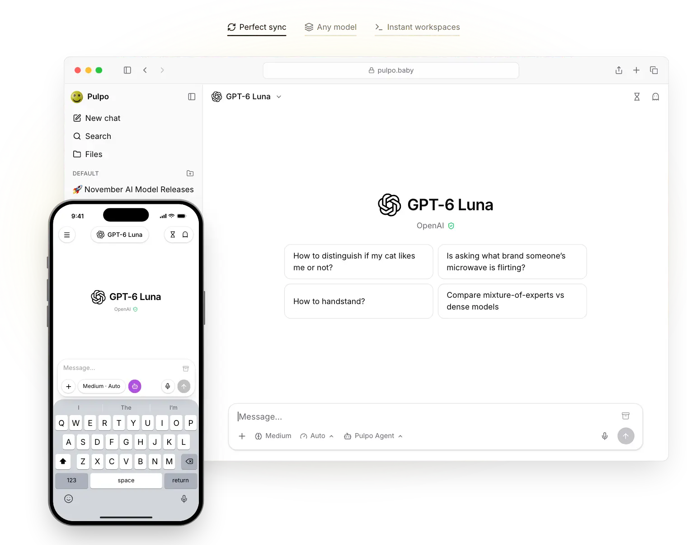
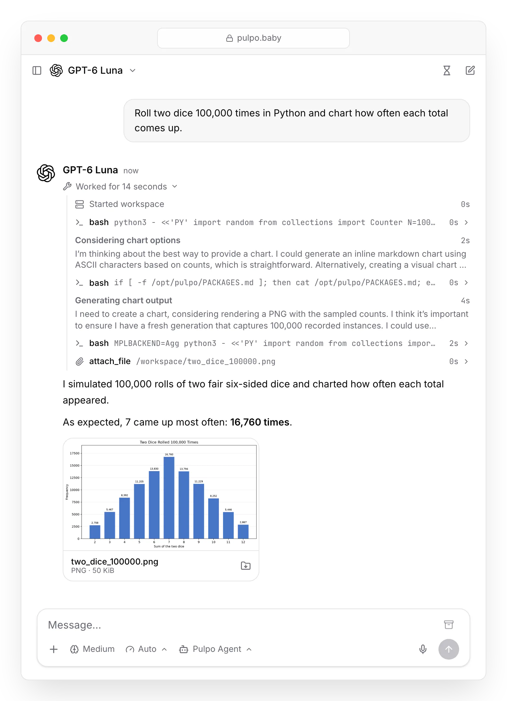
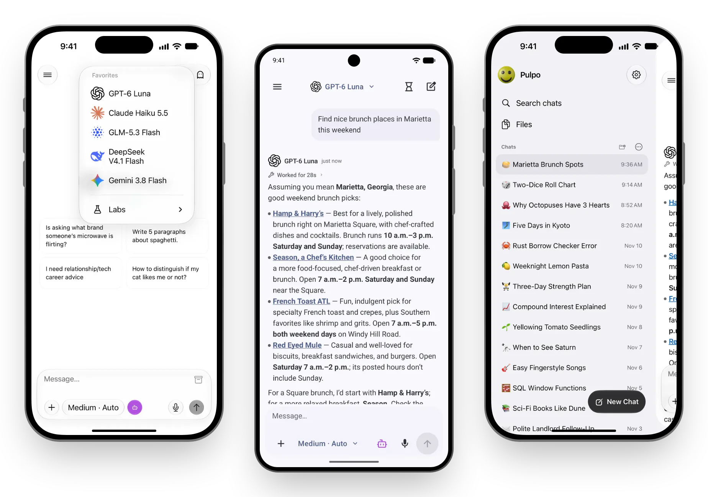

<div align="center">


# Pulpo

**Self-hosted chatbot for everyday use**

Native apps for iPhone and Android, a disposable Linux workspace for every agent task, and any model you like. Everything stays in sync across your devices.

[Website](https://pulpo.baby) · [Docs](https://help.pulpo.baby) · [Self-host](#self-host) · [Get the apps](#get-the-apps)

[](https://github.com/IsaacThoman/pulpo/releases/latest)
[](LICENSE.md)

</div>

<picture>
  <source media="(prefers-color-scheme: dark)" srcset="assets/readme/demo-dark.webp">
  
</picture>

<p align="center"><sub>One account in a browser and on an iPhone, replaying real answers.</sub></p>

## What you get

### Any model

Run open-weight models on your own GPUs, so conversations can stay on your network, or use the hosted APIs you already pay for. You can switch models and providers in the middle of a conversation.

Pulpo speaks the OpenAI Responses, OpenAI Chat Completions, Anthropic Messages, and Mistral APIs. That covers vLLM, llama.cpp, Ollama, OpenRouter, Azure AI Foundry, Fireworks, Baseten, and the model labs' own APIs. See [Provider API formats](https://help.pulpo.baby/provider-api-formats).

### A fresh computer for every task

Turn on Agent mode and the model gets its own Linux machine to run commands, write code, and work with files. Workspaces are claimed from a warm pool, so they start in an instant.

<p align="center">
  <picture>
    <source media="(prefers-color-scheme: dark)" srcset="assets/readme/workspace-dark.webp">
    
  </picture>
</p>

- **Isolated.** Every session runs in its own lightweight virtual machine, with nothing shared between chats or people.
- **Ready to work.** Python, Node.js, Git, and FFmpeg come preinstalled, along with tools for spreadsheets, PDFs, Word, and PowerPoint.
- **Disposable.** The agent has root, and nothing it does can outlive the session. What you want to keep goes to your Files.

### Native apps

The mobile apps are built with SwiftUI and Liquid Glass on iOS and Material 3 Expressive on Android. They sign in to any Pulpo instance, including your own.

<p align="center">
  <picture>
    <source media="(prefers-color-scheme: dark)" srcset="assets/readme/apps-dark.webp">
    
  </picture>
</p>

### Perfect sync

Every device shows the same thing at the same moment. A draft typed in the browser appears on your phone as you type it, a model picked on one device changes on the others, and an answer streams to all of them at once.

### And everything else you'd expect

- **Files and documents.** Folders, uploads, and collaborative documents live next to your chats, and agents can work on them.
- **Memory and search.** Pulpo can recall earlier conversations and search them by meaning, not just by keyword.
- **Voice.** Dictate a message, or have any answer read aloud with playback controls.
- **Image generation.** Agents create images with the image models you connect.
- **Quizzes and flashcards.** Ask to be quizzed and the reply becomes an interactive quiz with hints and a score.
- **Sharing.** Publish a conversation as a public link that anyone can read.
- **Developer API.** OpenAI- and Anthropic-compatible endpoints, with keys you issue yourself.
- **Passkeys and two-factor.** Sign in with a passkey or protect your account with a second factor.
- **Administration.** Manage providers, models, people, and budgets from the admin panel or the `pulpo` command line.
- **No telemetry.** Pulpo never phones home. There are no analytics, crash reports, or usage data sent back to us, in the server or in the apps.

## Get the apps

| Platform | Where to get it |
| --- | --- |
| iPhone and iPad | [App Store](https://apps.apple.com/us/app/pulpo-ai/id6798530217) |
| Android | APK on the [latest release](https://github.com/IsaacThoman/pulpo/releases/latest) |
| macOS and Windows | Desktop app on the [latest release](https://github.com/IsaacThoman/pulpo/releases/latest) |
| Web | Any modern browser, with nothing to install |
| Command line | `npm i -g @isaacthoman/pulpo`, for [administering an instance](apps/cli/README.md) |

The mobile apps sign in to [pulpo.baby](https://pulpo.baby), the hosted instance, which currently has a waitlist. To use your own server instead, choose **Change server** on the sign-in screen and enter its `https://` address.

## Self-host

Pulpo runs on one machine with Docker Compose: the web app, the API, a background worker, PostgreSQL, Redis, S3-compatible file storage, and Ollama for chat memory start together. To try it on your computer:

```sh
git clone --branch main https://github.com/IsaacThoman/pulpo.git
cd pulpo
cp .env.example .env
sed -i.bak "s|^ENCRYPTION_KEY=.*|ENCRYPTION_KEY=$(openssl rand -hex 32)|" .env && rm .env.bak
docker compose up -d --build
```

The `main` branch holds the latest release. The first build takes several minutes. When it finishes, open `http://localhost:8080` and create the administrator account, then add a model provider under **Admin panel → Providers**.

This setup is for one computer over plain HTTP, so don't put it on the internet. The [self-hosting guide](https://help.pulpo.baby/self-hosting) covers the rest:

- [Running on a server](https://help.pulpo.baby/self-hosting#run-it-on-a-server) with a domain name and HTTPS.
- [Local models](https://help.pulpo.baby/self-hosting#local-models) from Ollama, vLLM, or llama.cpp on your own network.
- [Backups](https://help.pulpo.baby/self-hosting#backups), including [encrypted offsite backups](https://help.pulpo.baby/backups).
- [Agent workspaces](https://help.pulpo.baby/self-hosting-agent-workspaces). Agent mode is optional and needs a second machine with hardware virtualization, where each workspace runs as its own small VM. Chat works without it.

You need Docker with the Compose plugin, 2 CPU cores, 4 GB of RAM, and 15 GB of free disk. The images build for x86-64 and ARM64.

## Repository

The code for the whole stack is here.

| Path | What it is |
| --- | --- |
| [`apps/server`](apps/server) | The API and background worker (Fastify, PostgreSQL, Redis) |
| [`apps/web`](apps/web) | The web app (React, Vite, Tailwind CSS) |
| [`apps/mobile`](apps/mobile) | The iOS and Android apps (React Native and Expo, with SwiftUI and Jetpack Compose views) |
| [`apps/desktop`](apps/desktop) | The macOS and Windows app (Electron) |
| [`apps/keyboard-ios`](apps/keyboard-ios) | Pulpo Keyboard, a native iOS keyboard with slide-to-type and dictation |
| [`apps/cli`](apps/cli) | The `pulpo` command line for administering an instance |
| [`packages`](packages) | Shared contracts and client logic, and the workspace controller and daemon |
| [`infra`](infra) | The workspace image, and the controller, network, and storage setup for agent workspaces |
| [`docs`](docs) | The documentation published at [help.pulpo.baby](https://help.pulpo.baby) |

## Development

Start the stack as in [Self-host](#self-host), from a clone of the `dev` branch. It publishes the API on `127.0.0.1:3000`, which the web app's dev server uses:

```sh
npm ci
npm run build -w @pulpo/contracts && npm run build -w @pulpo/client-core
npm run dev    # the web app with hot reload, on http://localhost:5173
npm test
npm run lint
```

Pull requests target the `dev` branch, and commits follow [Conventional Commits](https://www.conventionalcommits.org). Releases are cut from `main`.

## Help

Report a problem or ask for help in the [issue tracker](https://github.com/IsaacThoman/pulpo/issues). Leave out passwords, tokens, provider keys, and private conversations.

## License

Pulpo is published under the [Pulpo Noncommercial License](LICENSE.md). Personal and other noncommercial use is free. Using it inside a for-profit company, offering it to others commercially, or turning on the billing features needs a separate commercial license: write to support@pulpo.baby.
