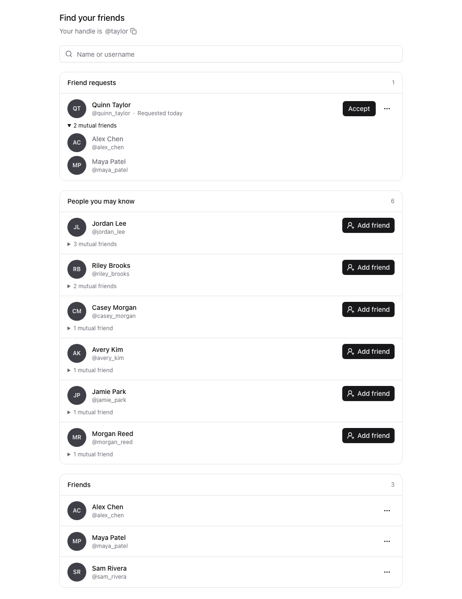
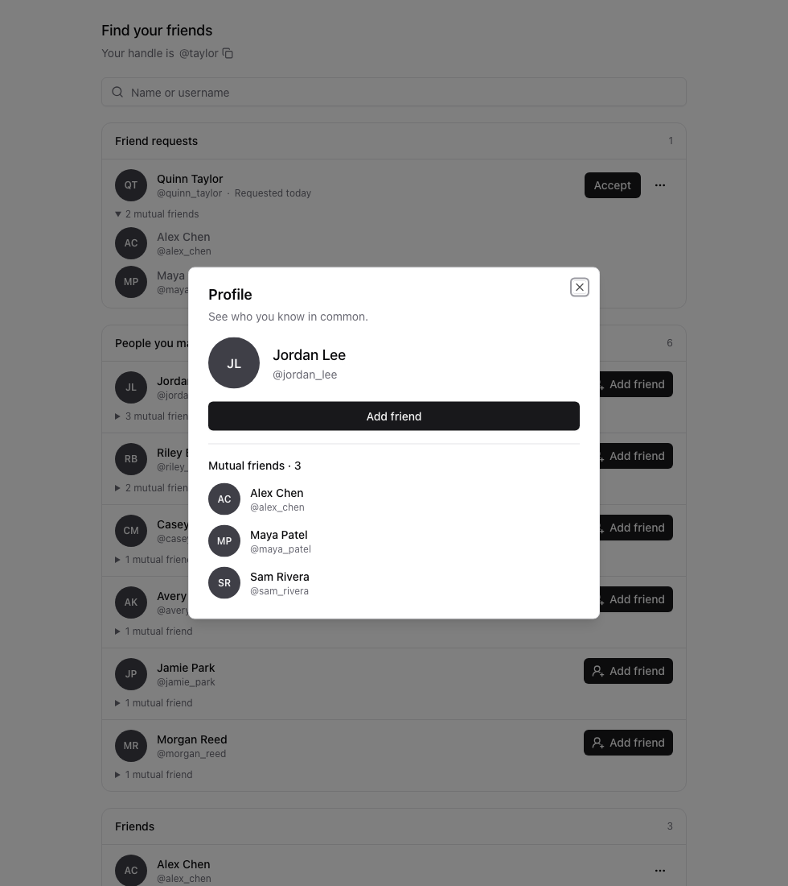

# Friend discovery UI baselines

These screenshots show the actual web Friends page with fixture accounts, including six suggestions, expanded request mutuals, and the profile dialog. They contain no live account data.





Discovery uses accepted friendships in either direction, ranks by the number of visible mutual friends, and returns at most six people. Existing friends, pending requests, unavailable accounts, and blocks in either direction are excluded. Mutual lists also exclude blocked edges between the other person and a mutual friend. Profiles expose only the existing public identity fields, relationship status, and mutual friends.

Validation covers PostgreSQL discovery and profile routes, web interactions, and iOS/Android screen interactions through the existing native-component mocks. The web page and profile dialog were also checked at 390px for overflow. Native simulator rendering was not checked.

To run the database tests, migrate a **disposable database named `pulpo_friends_test`**, then run:

```sh
PULPO_FRIENDS_POSTGRES_TEST=1 DATABASE_URL=postgres://.../pulpo_friends_test npm run test -w @pulpo/server -- src/friends/discovery.postgres.test.ts
```

The other focused checks are:

```sh
npm run test -w @pulpo/web -- src/pages/FriendsPage.pool.test.tsx
npm run test -w @pulpo/mobile -- src/features/friends
```
